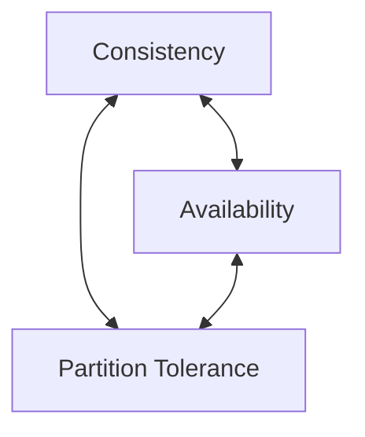
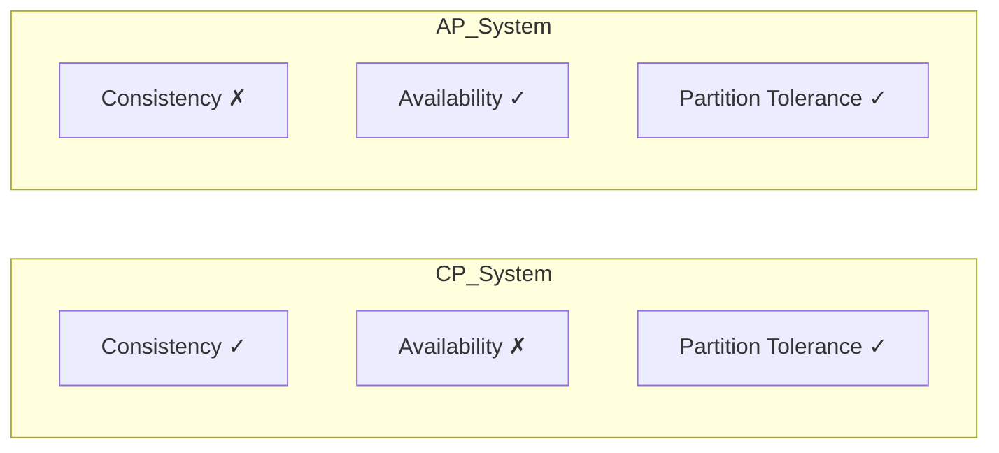
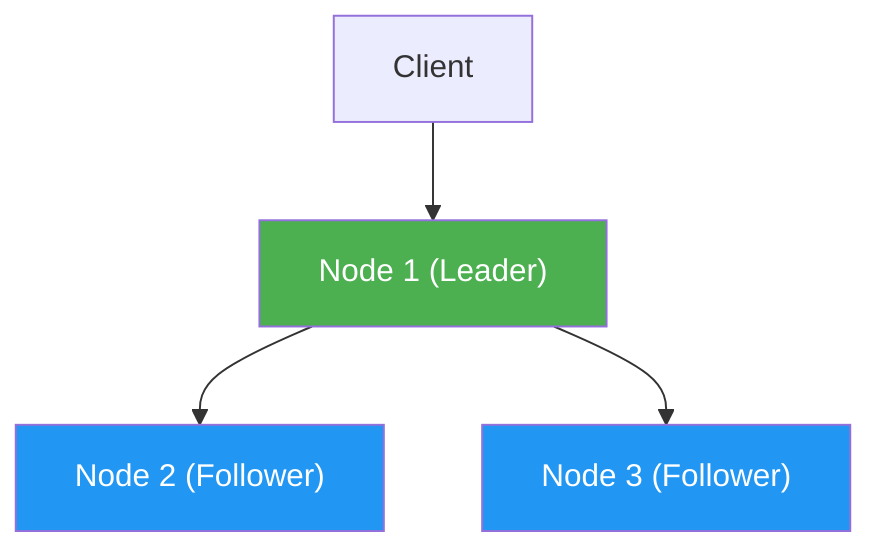
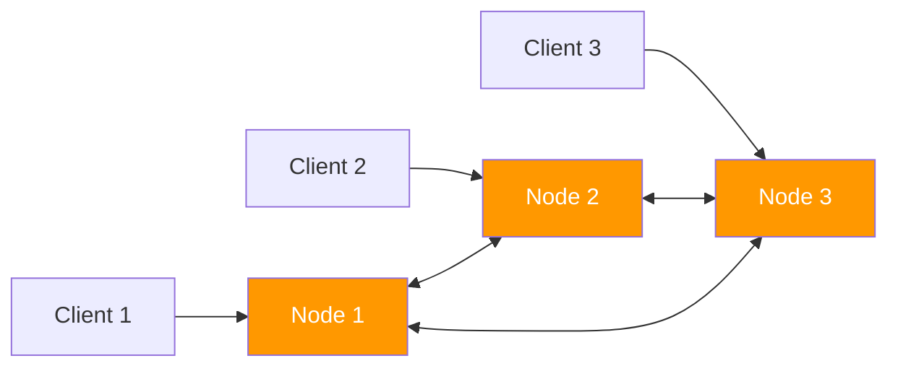

# CAP Theorem Demonstration

This project is **an educational example to demonstrate CAP theorem concepts**. It's a simplified implementation and should NOT be used in production. Real-world distributed systems use much more sophisticated algorithms and tools.

## What is CAP Theorem?
-------------------------
CAP theorem states that in a distributed system, you can only achieve **two out of three properties simultaneously**:

### CAP Triangle Diagram:


### Properties:
- **Consistency (C)**: All nodes see the same data at the same time
- **Availability (A)**: Every request gets a response (success or failure)
- **Partition Tolerance (P)**: System continues to work despite network partitions

### Why CA is Not Possible
------------------------
CA (Consistent + Available) systems are impossible because **partition tolerance is mandatory in distributed systems**. Network partitions are inevitable (network failures, latency, etc.), so you must choose between CP or AP.

#### CA vs CP vs AP Diagram:


## Project Setup
-------------
1. Install dependencies:
   ```bash
   npm install
   ```

## CP Example (Consistent + Partition Tolerant)
---------------------------------------------------
This example prioritizes Consistency over Availability during partitions.

### CP System Architecture Diagram:


### How to run:
```bash
npm run cp
```

### Endpoints:
- `GET http://localhost:3001/data` - Read data
- `POST http://localhost:3001/data` - Write data (requires JSON body: `{"value": "new value"}`
- `POST http://localhost:3001/partition` - Toggle partition mode (requires JSON body: `{"partitioned": true/false}`

### How it works:
When writing data, the system ensures all nodes have the same data before responding. If a partition occurs, it rejects writes to maintain consistency.

## AP Example (Available + Partition Tolerant)
-------------------------------------------------
This example prioritizes Availability over Consistency during partitions.

### AP System Architecture Diagram:


### How to run:
```bash
npm run ap
```

### Endpoints:
- `GET http://localhost:4001/data` - Read data from node 1
- `POST http://localhost:4001/data` - Write data to node 1 (requires JSON body: `{"value": "new value"}`
- `GET http://localhost:4002/data` - Read data from node 2
- `POST http://localhost:4002/data` - Write data to node 2
- `GET http://localhost:4003/data` - Read data from node 3
- `POST http://localhost:4003/data` - Write data to node 3

### How it works:
Every node accepts reads and writes even when partitioned. It uses version numbers to resolve conflicts when partitions heal (eventual consistency).

## Key Differences
---------------------
| Property | CP | AP |
|----------|----|----|
| Consistency | Strong | Eventual |
| Availability | May reject requests | Always responds |
| Use case | Banking, financial systems | Social media, e-commerce product listings |
